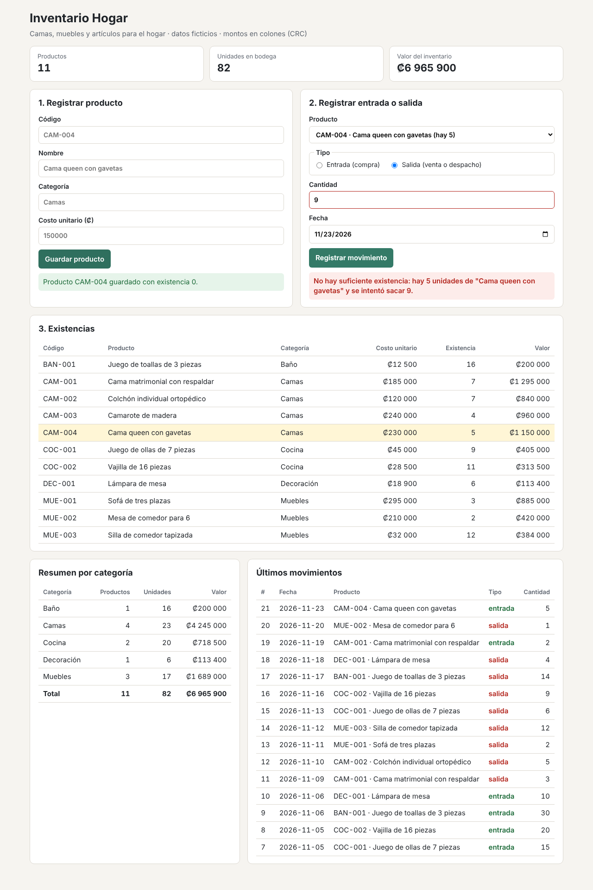

# Inventario Hogar

Prototipo de control de inventario para una tienda costarricense de camas, muebles y artículos para el hogar.
Es el proyecto final del curso SINT-732, Laboratorio Ejecutivo en Claude Code (Universidad CENFOTEC).

El proceso completo es registrar un producto, registrar sus entradas y salidas, y consultar existencias, valor en colones (CRC) y resumen por categoría. La regla central es que **una salida nunca puede dejar la existencia en negativo**.

Todos los datos son ficticios y el repositorio no contiene credenciales.



## Requisitos

- Node.js 20 o superior (se probó con 22). Compruébalo con `node --version`.
- No hay dependencias que instalar.

## Cómo usarlo

```bash
npm start          # arranca el servidor en http://localhost:3000
npm test           # corre las 12 pruebas automatizadas
npm run reiniciar  # vuelve los datos al estado ficticio inicial
```

Para usar otro puerto en Windows: `set PORT=4000 && npm start`.

## Estructura

| Ruta | Contenido |
| --- | --- |
| `intent.md` | Problema, usuario, alcance e indicadores de éxito |
| `spec.md` | Requisitos RF-01 a RF-04, reglas, datos, arquitectura y decisiones técnicas |
| `plan.md` | Tareas, dependencias, estado y trazabilidad requisito → tarea → prueba |
| `src/servicio.js` | Reglas de negocio y cálculos (sin pantalla ni archivos) |
| `src/repositorio.js` | Lectura y escritura del archivo JSON |
| `src/servidor.js` | Servidor HTTP y rutas `/api/...` |
| `public/` | Interfaz web (HTML, CSS y JavaScript que solo presenta datos) |
| `datos/semilla.json` | 10 productos y 20 movimientos ficticios |
| `datos/inventario.json` | Datos de trabajo; se crea al primer arranque y no se sube a Git |
| `pruebas/` | Pruebas automatizadas (`node --test`) |
| `docs/uso-ia.md` | Ciclos de trabajo con IA y revisión humana |
| `docs/negocio.md` | Beneficio, costos, limitaciones y adopción |
| `docs/demo.md` | Guion de la demo de 12 minutos con caso de error |
